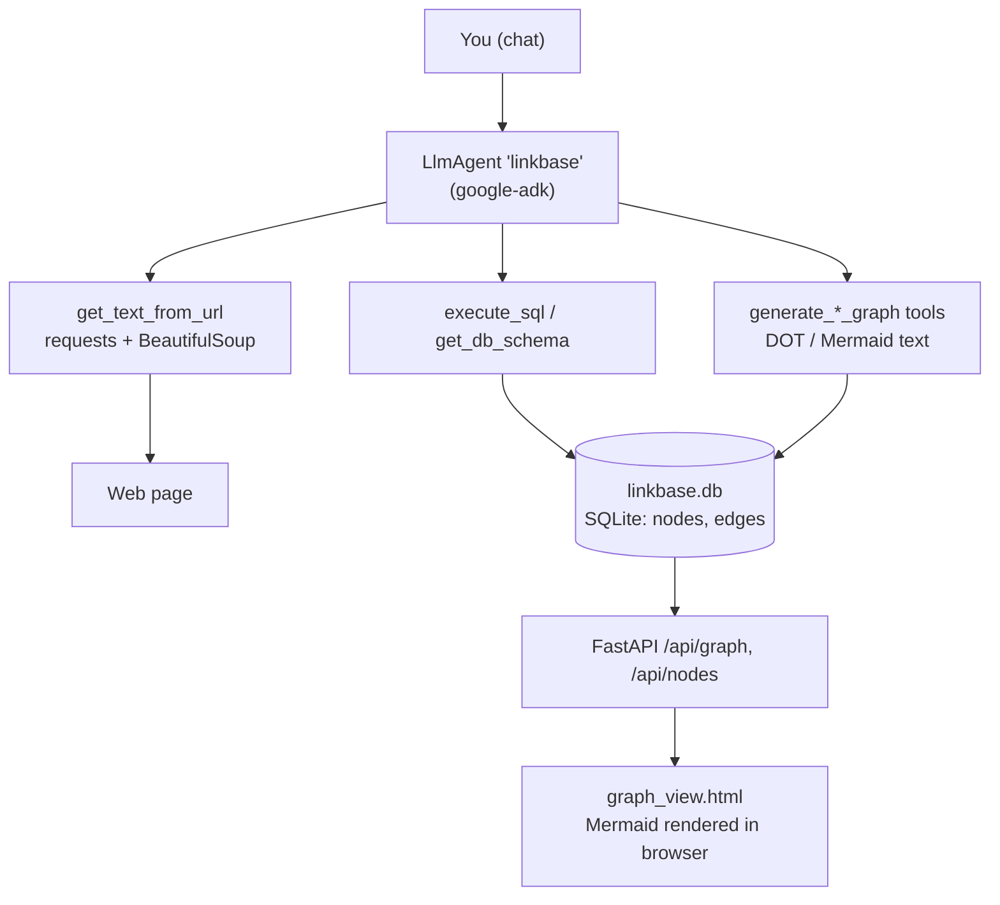

# Linkbase

**AI-assisted, graph-powered knowledge database.**

Linkbase turns unstructured text — typically web pages — into a queryable knowledge graph.
An LLM agent (built on [Google ADK](https://google.github.io/adk-docs/)) reads a URL, extracts
entities (*nodes*) and the relationships between them (*edges*), and stores them in a local SQLite
database. A small FastAPI web app then lets you explore that graph interactively as a Mermaid
diagram.

---

## Table of contents

- [How it works](#how-it-works)
- [Features](#features)
- [Project layout](#project-layout)
- [Requirements](#requirements)
- [Installation](#installation)
- [Configuration](#configuration)
- [Running the agent](#running-the-agent)
- [Running the graph viewer](#running-the-graph-viewer)
- [HTTP API](#http-api)
- [Data model](#data-model)
- [Agent tools reference](#agent-tools-reference)
- [Logging](#logging)
- [Known limitations](#known-limitations)
- [License](#license)

---

## How it works



The agent and the web viewer are two independent entry points over the same SQLite file:

1. **Ingestion** — you chat with the agent (`adk web` / `adk run`), give it a URL, and it fetches
   the page, decides on nodes and edges, and writes them with plain `INSERT` statements.
2. **Exploration** — the FastAPI server reads the same database and serves JSON, which the browser
   turns into a Mermaid diagram with filtering controls.

## Features

- **URL → knowledge graph.** Fetches and strips a page to plain text, then lets the LLM infer
  entities and their relationships from context.
- **Plain SQLite storage.** No graph database to run; the whole knowledge base is one `.db` file
  you can query with any SQL client.
- **Three graph views**, available both as agent tools and in the web UI:
  - **Full graph** — everything in the database.
  - **Node-centric** — a BFS neighbourhood around one node, to a configurable depth.
  - **Paths** — every directed path between two nodes, up to a maximum length.
- **Two output formats from the agent** — Graphviz **DOT** and **Mermaid** text, for whichever
  renderer you prefer.
- **Interactive viewer** — dropdowns for picking nodes, plus client-side whitelist/blacklist
  filters on node and edge labels, applied without re-querying the server.
- **Case-insensitive deduplication.** Node names are normalized, so `" New York City "` and
  `"new york city"` are the same node.
- **Swappable model.** Ships pointed at Gemini, but ADK's LiteLLM wrapper is already wired in for
  local models via Ollama.

## Project layout

```
linkbase/
├── linkbase/
│   ├── __init__.py            # exposes `agent` so ADK discovers the package
│   ├── agent.py               # LlmAgent definition: model, instruction, tool list
│   ├── web_tools.py           # get_text_from_url — fetch + strip a page to plain text
│   ├── db_tools.py            # SQLite schema, execute_sql, node/edge helpers
│   ├── graph_tools.py         # graph queries + DOT / Mermaid generation
│   ├── web_server.py          # FastAPI app: /api/graph, /api/nodes, /
│   ├── logger_config.py       # root logger → linkbase/linkbase.log
│   └── templates/
│       └── graph_view.html    # single-page viewer (vanilla JS + Mermaid from CDN)
├── requiremements.txt         # dependency list (filename typo is intentional/known)
└── LICENSE
```

## Requirements

- **Python 3.12 or newer.** `graph_tools.py` uses [PEP 701](https://peps.python.org/pep-0701/)
  f-strings (nested quotes and backslashes inside `{...}`), which are a syntax error on 3.11 and
  below.
- An API key for a Gemini model, **or** a local [Ollama](https://ollama.com/) install if you switch
  the model (see [Configuration](#configuration)).
- Outbound internet access — for the LLM API, for fetching the pages you ingest, and for the
  Mermaid bundle the viewer loads from jsDelivr.

## Installation

```bash
git clone https://github.com/lapeyus/linkbase.git
cd linkbase

python3.12 -m venv .env
source .env/bin/activate          # Windows: .env\Scripts\activate

pip install --upgrade pip
pip install -r requiremements.txt
```

> The requirements file is named `requiremements.txt` (with the typo) in this repo — use it
> verbatim. It does not list `python-dotenv`, which `agent.py` imports; it normally arrives as a
> transitive dependency of `google-adk`, but if the import fails, `pip install python-dotenv`.

Pinned dependencies: `google-adk`, `litellm`, `mcp`, `requests`, `beautifulsoup4`, `fastapi`,
`uvicorn`.

## Configuration

Create a `.env` file in the project root (it is git-ignored). `agent.py` loads it with
`load_dotenv()` before the agent is constructed.

**Gemini via Google AI Studio:**

```dotenv
GOOGLE_GENAI_USE_VERTEXAI=FALSE
GOOGLE_API_KEY=your-api-key-here
```

**Gemini via Vertex AI:**

```dotenv
GOOGLE_GENAI_USE_VERTEXAI=TRUE
GOOGLE_CLOUD_PROJECT=your-project-id
GOOGLE_CLOUD_LOCATION=us-central1
```

### Changing the model

The model is hard-coded in `linkbase/agent.py:23`:

```python
root_agent = LlmAgent(
    # model=LiteLlm(model="ollama/qwen3:30b"),
    model='gemini-2.5-pro-preview-05-06',
    ...
)
```

To run against a local model instead, uncomment the `LiteLlm` line and comment out the Gemini one.
Any [LiteLLM-supported](https://docs.litellm.ai/docs/providers) model string works; note that
extraction quality depends heavily on the model's tool-calling ability.

## Running the agent

Run ADK from the **project root** (the directory that contains the `linkbase/` package) — ADK
discovers the agent through `linkbase/__init__.py`, which re-exports `root_agent`.

```bash
adk web            # browser chat UI at http://localhost:8000
# or
adk run linkbase   # terminal chat
```

On import, the agent calls `initialize_database()`, which creates `linkbase.db` in the **current
working directory** if it doesn't exist yet.

### Example prompts

```
Read https://en.wikipedia.org/wiki/Ada_Lovelace and store the entities and
relationships you find in the graph.

Show me the schema of the database.

Which nodes are connected to "ada lovelace"? Give me a node-centric Mermaid
graph, depth 2.

Generate a DOT graph of the paths between "ada lovelace" and "united kingdom".

How many nodes and edges are there in total?
```

## Running the graph viewer

```bash
python -m linkbase.web_server
```

Then open <http://localhost:8080>. Run it from the same working directory you ran the agent from,
so it picks up the same `linkbase.db`.

The page gives you:

- **Load Full Graph** — the entire database.
- **Center on Node** + depth — the neighbourhood around one node.
- **Path Start/End Node** + max depth — every directed path between two nodes.
- **Dynamic filters** — multi-select node and edge labels, then *Show All* / *Show Only Selected* /
  *Hide Selected*. Filtering happens in the browser on the already-loaded data, so it's instant.

Colour conventions in the rendered diagram: the centered node is light blue, a path's start node is
green, and its end node is red. When one source node has several targets sharing the same edge
label, the viewer collapses them into a small circular fan-out node to keep the diagram readable.

## HTTP API

### `GET /`

Serves `linkbase/templates/graph_view.html`.

### `GET /api/nodes`

Returns every node, sorted by name — used to populate the UI dropdowns.

```json
[{ "id": 1, "name": "ada lovelace", "label": "Person" }]
```

### `GET /api/graph`

Returns the node and edge lists for one of three views. The mode is chosen by which query
parameters you pass:

| Parameter | Type | Default | Description |
|---|---|---|---|
| `center_node` | string | — | Node **name**. Returns the neighbourhood around it (node-centric mode). |
| `node_centric_depth` | int | `1` | BFS depth for node-centric mode. |
| `start_node` | string | — | Node name. With `end_node`, returns all paths between them. |
| `end_node` | string | — | Node name. Required together with `start_node`. |
| `path_max_depth` | int | `5` | Maximum number of edges in a path. |

With no parameters, the full graph is returned.

```jsonc
// GET /api/graph?center_node=ada%20lovelace&node_centric_depth=2
{
  "nodes": [{ "id": 1, "name": "ada lovelace", "label": "Person" }],
  "edges": [{ "id": 1, "source_id": 1, "target_id": 2, "label": "collaborated_with" }],
  "center_node_id": 1,
  "start_node_id": null,
  "end_node_id": null,
  "error_message": null
}
```

Missing nodes and "no path found" are **not** HTTP errors — the response comes back `200` with
empty lists and a human-readable `error_message`. Only `/api/nodes` raises `500` when the database
read fails outright.

## Data model

Two tables, created on first run by `initialize_database()`:

```sql
CREATE TABLE nodes (
  id    INTEGER PRIMARY KEY AUTOINCREMENT,
  name  TEXT UNIQUE NOT NULL,
  label TEXT
);

CREATE TABLE edges (
  id        INTEGER PRIMARY KEY AUTOINCREMENT,
  source_id INTEGER NOT NULL,
  target_id INTEGER NOT NULL,
  label     TEXT,
  FOREIGN KEY(source_id) REFERENCES nodes(id),
  FOREIGN KEY(target_id) REFERENCES nodes(id),
  UNIQUE(source_id, target_id, label)
);
```

- `name` is the entity itself (`"ada lovelace"`); `label` is its type or display name
  (`"Person"`). The web viewer shows `label` when present and falls back to `name`.
- **Normalization** (`_normalize_text`): lowercase + strip. Applied to node names on both write and
  lookup, so casing and stray whitespace never create duplicates.
- Edges are **directed** (`source_id → target_id`). The `UNIQUE` constraint means the same relation
  with the same label is stored only once.
- Path search follows outgoing edges only. Node-centric search follows edges in **both** directions.
- `linkbase.db` lives in the process's current working directory (`DB_FILE = "linkbase.db"`), so
  always start the agent and the web server from the same directory.

### Helper functions

`db_tools.py` also provides `get_node_by_name()`, `get_or_create_node()` and
`add_edge_if_not_exists()`, which handle normalization and deduplication for you. They are **not**
exposed to the agent — the agent writes through raw `execute_sql` — but they are useful from
scripts, and `python -m linkbase.db_tools` runs a short demo that exercises them and prints the
resulting schema, nodes and edges.

## Agent tools reference

| Tool | Signature | Purpose |
|---|---|---|
| `get_text_from_url` | `(url: str) -> str` | Fetch a page (10s timeout), drop `<script>`/`<style>`, return cleaned plain text. |
| `get_db_schema` | `() -> str` | Return the `CREATE TABLE` statements plus per-column details. |
| `execute_sql` | `(sql_command: str, params: list[str] \| None) -> list[tuple] \| int \| str` | Run any SQL. Returns rows for `SELECT`, affected-row count for DML, or an error string. |
| `generate_dot_graph` | `() -> str` | Full graph as Graphviz DOT. |
| `generate_mermaid_graph` | `() -> str` | Full graph as Mermaid. |
| `generate_node_centric_dot_graph` | `(center_node_name: str, depth: int = 1) -> str` | Neighbourhood as DOT; the centered node is filled light blue. |
| `generate_node_centric_mermaid_graph` | `(center_node_name: str, depth: int = 1) -> str` | Neighbourhood as Mermaid. |
| `generate_paths_dot_graph` | `(start_node_name: str, end_node_name: str, max_depth: int = 5) -> str` | All paths as DOT; start green, end red. |
| `generate_paths_mermaid_graph` | `(start_node_name: str, end_node_name: str, max_depth: int = 5) -> str` | All paths as Mermaid. |

Every tool degrades to a descriptive string instead of raising, so the model can read the failure
and retry.

## Logging

`logger_config.py` configures the **root** logger at import time, so every module that calls
`logging.getLogger(__name__)` inherits it. Logs are appended to `linkbase/linkbase.log` — next to
the source, not in the working directory — with the format:

```
2025-06-01 12:00:00,000 - linkbase_app - INFO - Database 'linkbase.db' already exists.
```

There is no console handler by default; uncomment the `StreamHandler` block in
`logger_config.py:33-36` if you want logs on stdout too. To change verbosity, call
`setup_global_logger(logging.DEBUG)` — the SQL statements themselves are logged at `DEBUG`.

## Known limitations

These are current, deliberate trade-offs of a small project — worth knowing before you point it at
anything sensitive:

- **The agent executes arbitrary SQL.** `execute_sql` passes model-generated statements straight to
  SQLite, including `DROP` and `DELETE`. Treat the database as untrusted-writable and keep backups
  of `linkbase.db`.
- **No authentication on the web server.** `uvicorn` binds `0.0.0.0:8080`, so it is reachable from
  your whole network. It is read-only, but don't expose it to the internet as-is.
- **`get_text_from_url` fetches whatever URL the model asks for**, with no allowlist. It follows
  ordinary `requests` redirect behaviour.
- **The viewer needs internet access** even for a local database, because Mermaid is loaded from
  the jsDelivr CDN.
- **The agent's DOT/Mermaid tools return escaped newlines** (`\n` as two literal characters) rather
  than real line breaks — the strings are meant to be passed through a renderer, and the web UI
  un-escapes them before rendering. Copy-pasting the raw tool output into a file may need a
  `\n` → newline pass first.
- **`mcp` is pinned in the requirements but not used** anywhere in the code yet.
- **There are no automated tests.** The `__main__` block in `db_tools.py` is the closest thing to a
  smoke test.
- The agent's instruction describes node-centric graphs as showing "direct outgoing connections",
  but the implementation walks incoming edges too.

## License

Apache License 2.0 — see [LICENSE](LICENSE).
